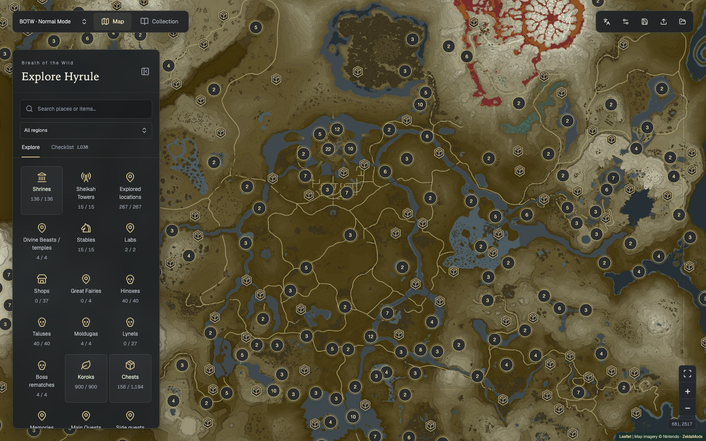

# botw-totk-atlas

A local-first exploration atlas for **Breath of the Wild** and **Tears of the Kingdom**.

Import a save, keep separate profiles for each playthrough, and find what remains on a map or checklist. Saves are read in the browser and are never modified or uploaded.

## Features

- Interactive maps for BOTW and TOTK's Sky, Surface, and Depths, with category and text filters.
- Separate profiles for BOTW Normal Mode, BOTW Master Mode, and TOTK.
- Import a save file or a folder. Folder imports can detect BOTW mode from companion metadata.
- Browse both maps without a save, or create a profile and mark progress by hand.
- Track shrines, treasure chests, Koroks, quests, and other collection records. Updating a profile from a save preserves manual marks for points whose progress cannot be read from that save.
- Export and restore individual profiles or all profiles as JSON.
- English, Simplified Chinese, Traditional Chinese, Japanese, and Korean interfaces, with official localized game names where available.

## Credits

- [jv-prado/hyrule-tracker](https://github.com/jv-prado/hyrule-tracker) and [LucieTheFool/boomerang-tracker](https://github.com/LucieTheFool/boomerang-tracker) contributors — community map metadata, adapted under the MIT license.
- [ZeldaMods BOTW Object Map](https://objmap.zeldamods.org/) and [TOTK Object Map](https://objmap-totk.zeldamods.org/) — map imagery and game-data research.
- [marcrobledo/savegame-editors](https://github.com/marcrobledo/savegame-editors), MrCheeze and McSpazzy — save-format and completion-flag research.
- [sh0wer1ee/BotwText](https://github.com/sh0wer1ee/BotwText) and [sh0wer1ee/TotkText](https://github.com/sh0wer1ee/TotkText) — localized game-name indexes.
- Favicon vector from [Wikimedia Commons](https://commons.wikimedia.org/wiki/File:Triforce.svg).

Game imagery and text belong to Nintendo. Third-party notices are preserved in [NOTICE](public/catalogs/NOTICE.txt); source manifests are included with the [catalogs](public/catalogs/sources.json) and [localized names](public/labels/sources.json).

## License

[MIT](./LICENSE.md) License © [jinghaihan](https://github.com/jinghaihan)
